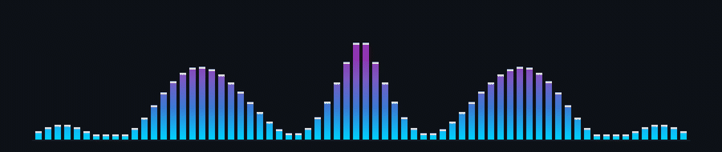

<p align="center">
  
</p>

<p align="center">
  <a href="https://git.io/typing-svg">
    
  </a>
</p>

<p align="center">
  <a href="https://mswk.com.br">
    
  </a>
  <a href="https://github.com/MonteiroBySWK">
    
  </a>
  <a href="https://linkedin.com/in/montbyswk">
    
  </a>
  
  
</p>

<p align="center">
  
</p>

### // 01. Overview

> *Scrubs bits at the lowest level for rendering experiments nobody asked for. Uses Arch, by the way.*

* **Role**: Working with **[@thera-org](https://github.com/thera-org)**, keeping cloud infrastructure from catching fire.
* **DevOps**: Putting out production fires — *nowadays, significantly less than it used to be.*
* **Homelab**: Runs a self-hosted homelab that occasionally decides to run him instead.
* **Autonomous Agents**: Babysitting code agents (they learn fast, they just never listen).
* **Code Philosophy**: Writes Rust when possible, C when the professor demands it, and Python when no one is looking.
* **Audio**: Producing deep house tracks whenever the groove hits — dissecting waveforms, basslines, and analog synths.

<p align="center">
  
</p>

### // 02. Stack & Tooling

```text
  [CORE / LOW-LEVEL]    Rust · C · Arch Linux · Lua
  [CLOUD / DEVOPS]      Docker · Kubernetes · AWS · Terraform · Homelab · CI/CD
  [RUNTIMES / SCRIPT]   Python · TypeScript · Java · Bash/Zsh
  [SOUND / HARDWARE]    Deep House · Sub-bass DSP · Analog Synths · 124 BPM
```

<div align="center">

| Area | Tools |
| :--- | :--- |
| **Low-Level & Systems** |     |
| **Cloud & Infrastructure** |     |
| **Languages & Scripting** |    |

</div>

<p align="center">
  
</p>

### // 03. Telemetry

<p align="center">
  
  &nbsp;
  
</p>

<p align="center">
  
</p>

### // 04. Incident Log

| Incident | Severity | Status | Post-Mortem |
| :--- | :---: | :---: | :--- |
| **03:00 AM Pager** | `CRITICAL` | `INVESTIGATING` | Production decided to test human cardiovascular health. |
| **"Monitored" Disk** | `HIGH` | `FULL (100%)` | Definitely monitored, until the alert daemon quietly crashed. |
| **Local-Only Config** | `BAFFLING` | `WONTFIX` | Works perfectly on Arch, refuses to boot anywhere else. |
| **Friday 17:30 Bump** | `FATAL` | `ROLLED_BACK` | Broke the pipeline right before the weekend. Unforgivable. |

> *All of them have been reported. None of them have been fixed. It's a lifestyle :)*

<p align="center">
  
</p>

<p align="center">
  <sub>G. Monteiro · <a href="https://mswk.com.br">mswk.com.br</a> · <a href="https://github.com/MonteiroBySWK">@MonteiroBySWK</a></sub>
</p>
